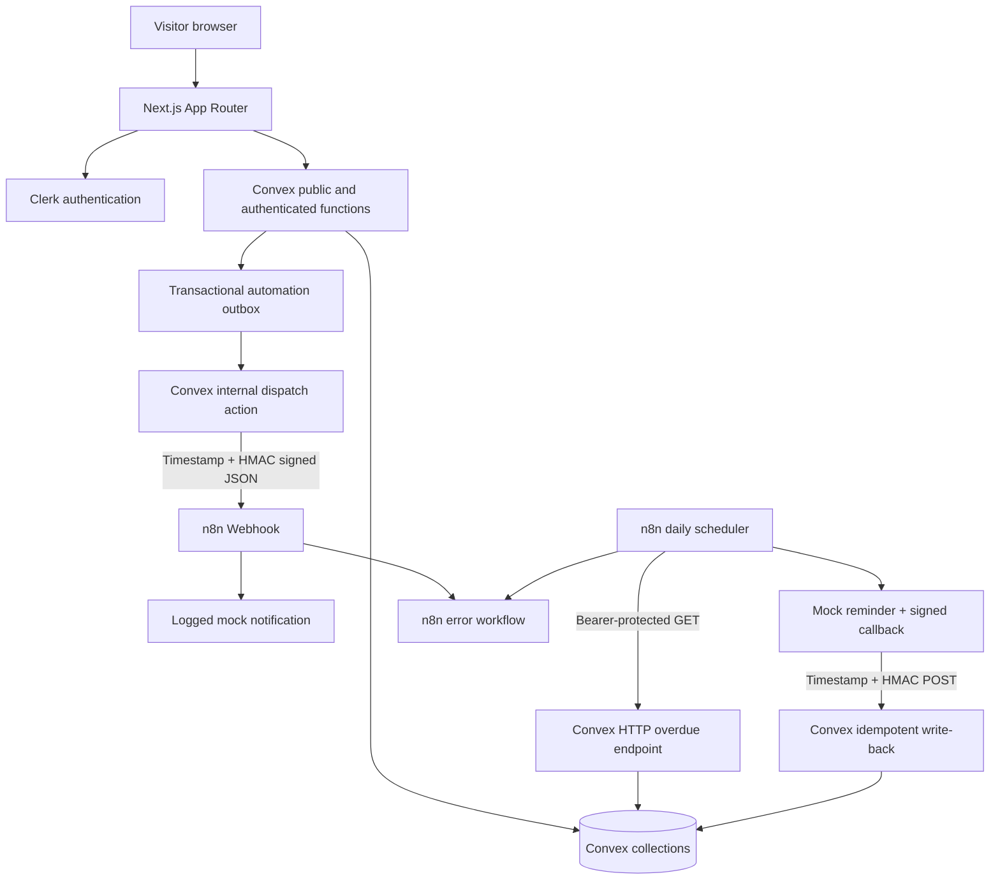

# LendLoop

A responsive neighborhood tool-sharing board. Visitors can see currently available tool names/categories. Signed-in neighbors can list tools, request loans, approve or decline incoming requests, and confirm returns. Admins can moderate listings, review all loans, and designate trusted lenders. Two n8n workflows handle signed request notifications and daily overdue reminders, backed by a separate failure workflow.

**Stack:** Next.js 16 App Router · React 19 · TypeScript · Clerk · Convex · n8n · Docker Compose · Web Crypto HMAC-SHA256.

> **Project status (November 4, 2026):** The Clerk/Convex development app is configured and the two-user listing, request, approval, and return flows have been manually exercised. All three n8n workflows are published locally. A signed local webhook delivery succeeded, tampered/stale requests were rejected and routed to the error workflow, and the overdue workflow authenticated to Convex and completed with an empty result set. The temporary public tunnel URL was unreachable during the final audit and must be refreshed before demonstrating Convex-to-n8n delivery. No public production deployment is claimed.

## Screens / views

- Public landing page: branding, tagline, available tools (only name + category), Clerk sign-in.
- Authenticated Explore: searchable tools with category, condition, availability, owner alias, trusted status, request dialog.
- My listings: add/edit/archive your own tool listings.
- My requests: request date range, track decisions, cancel pending request, view recent automation activity.
- Incoming requests: approve/decline, confirm returned loans, view automation activity.
- Admin: view all loans, remove any listing, grant/revoke trusted lender designation.

## Architecture



### Collections

| Table | Contents | Privacy boundary |
|---|---|---|
| `users` | Clerk subject, display alias, role, trusted flag | Only safe fields projected to authorized dashboards |
| `tools` | Owner ID, listing metadata, soft-delete flag | Public query projects **only name and category** |
| `requests` | Borrower, tool, UTC calendar dates, status | Restricted to borrower, owner, or admin |
| `automationEvents` | Event type, unique event key, delivery attempts/status, timestamps | Restricted to associated loan views/admin/internal automation |

**Request state machine:** `pending → approved / declined / cancelled`, `approved → returned`. Only a lender can approve/decline/confirm a return; only a borrower can cancel an outstanding request. Terminal states cannot be reopened. Approvals are transactional and reject overlapping approved date ranges, including matching endpoints. Borrowers cannot request their own listings.

## Prerequisites

- Node.js 22.12+, npm, Docker + Docker Compose (for self-hosted n8n).
- A **Clerk** account/application with **Convex integration / JWT template** enabled (template name `convex`).
- A **Convex** account/deployment.
- A public HTTPS route to your n8n webhook. Convex cloud cannot call `localhost`; use n8n Cloud, a deployed n8n instance, or a temporary HTTPS tunnel to local n8n for testing.

## Setup — application and data backend

1. `npm install`
2. Copy `.env.example` to `.env.local`; set:
   - `NEXT_PUBLIC_CLERK_PUBLISHABLE_KEY`, `CLERK_SECRET_KEY` from your Clerk application.
   - `NEXT_PUBLIC_CONVEX_URL` from your Convex development deployment (often filled by `npx convex dev`).
3. Create/link a Convex deployment with `npx convex dev`. The CLI generates the **schema-aware, strongly typed API** in `convex/_generated/`. Run it before `npm run dev` or `npm run typecheck`.
4. In Clerk, activate the Convex integration and configure the JWT template named `convex`.
5. In the **Convex dashboard → Settings → Environment Variables**, configure:
   - `CLERK_JWT_ISSUER_DOMAIN` = Clerk Frontend API / JWT issuer URL (`https://...clerk.accounts.dev` in development).
   - `ADMIN_CLERK_ID` = the exact Clerk **user ID** of the first administrator, e.g. `user_...`. Set this **before their first dashboard login**; no public API grants admin status.
   - `N8N_WEBHOOK_URL` = external production webhook `https://<n8n-public-host>/webhook/lendloop-events`.
   - `N8N_WEBHOOK_SECRET` = randomly generated HMAC secret, >= 32 bytes.
   - `N8N_CALLBACK_TOKEN` = separate random opaque bearer token, >= 32 bytes.
6. In one terminal run `npx convex dev`, in another run `npm run dev`, and open `http://localhost:3000`.

**Development notes:** Check the Clerk dashboard for enabled sign-in methods and allowed origins. After completing the Clerk configuration, sign in once to create the `users` profile. The public catalog intentionally starts empty. Tool data is created through authenticated user actions, not seeded with invented identities.

### Convex generated code

The schema-derived runtime and TypeScript bindings under `convex/_generated/` are committed so a clean checkout can type-check and build without deployment credentials. `npx convex dev` or `npx convex codegen` regenerates them after schema/function changes. Local Convex AI helper metadata under `convex/_generated/ai/` remains ignored; do not handwrite API references or replace the generated types with `any`.

## Setup — n8n via Docker

1. Copy `.env.example` to a **separate `.env`** file (Docker Compose reads it). Fill `N8N_ENCRYPTION_KEY`, `LENDLOOP_WEBHOOK_SECRET`, `LENDLOOP_CALLBACK_TOKEN`, `LENDLOOP_CONVEX_SITE_URL`.
2. `LENDLOOP_WEBHOOK_SECRET` must equal Convex's `N8N_WEBHOOK_SECRET`; `LENDLOOP_CALLBACK_TOKEN` must equal Convex's `N8N_CALLBACK_TOKEN`. Never prefix either with `NEXT_PUBLIC_`.
3. `docker compose up -d`, then open `http://localhost:5678` and create an n8n owner account.
4. Import the three JSON exports under `n8n/workflows/`:
   - `01-request-notifications.json`: Webhook → verify HMAC + timestamp → logged mock notification → respond `200`.
   - `02-overdue-reminders.json`: Daily at **09:00 UTC** → authenticated GET → split overdue loans → logged mock + HMAC-signed POST write-back.
   - `03-error-handler.json`: Error Trigger → sanitized execution failure log.
5. In each of the first two workflow settings, select **LendLoop — Automation error handler** as the error workflow. n8n usually allocates new IDs on import, so this manual association is intentional.
6. Activate/publish both primary workflows. If testing locally, expose port 5678 through a secured HTTPS tunnel and set `N8N_WEBHOOK_URL` in Convex to the **public production webhook URL**, not the test URL or `localhost`. Re-activate if the webhook URL changed.
7. Run a request through the dashboard, inspect n8n executions and `automationEvents`. To simulate overdue locally, use a short loan and test on the next UTC calendar day after its end date; inspect the daily scheduler manually before relying on automatic runs.

**Self-host hardening note:** The sample enables only Node's built-in `crypto` module inside n8n Code nodes (`NODE_FUNCTION_ALLOW_BUILTIN=crypto`) and, for the trusted local demonstration, permits Code nodes to reference environment variables. The example pins n8n 2.46.4 (stable on November 3, 2026); with external task runners, configure the crypto allowlist on the runner as well. Do **not** allow untrusted users to edit these workflows. Production should move secrets to scoped n8n credentials or a dedicated signer/verification service, isolate task runners, enforce TLS, restrict access to the n8n UI, and enable durable storage/backups. No secret values are present in exported JSON.

## Security and privacy decisions

1. **Never trust the UI.** Every protected Convex query/mutation reads `ctx.auth.getUserIdentity()`, resolves a server-side profile from Clerk subject, and re-checks ownership and role. The client never supplies a trusted `ownerId`, `borrowerId`, or role. Admin creation is configured server-side and cannot be self-selected.
2. **Data minimization.** Anonymous users receive *only* active available tool IDs, names, and categories. No owner IDs/names, descriptions, dates, emails, borrower identities, or automation history. Authenticated users see only contextually necessary identities.
3. **Transactional lending.** Status changes and overlap checks happen in the same Convex mutation, preventing concurrent approvals from accepting mutually conflicting loans. Archived listings remain in history; active loans prevent removal.
4. **Signed outbound events.** Convex signs `${timestamp}.${rawJson}` with HMAC-SHA256. n8n verifies the same raw payload with a constant-time comparison and rejects timestamps outside a five-minute window. Responses are only acknowledged after verification and mock dispatch. Convex dispatch uses an outbox, records delivery status, and retries with capped exponential backoff (maximum five attempts).
5. **Authenticated and signed callbacks.** n8n reads due loans with a separate bearer token. Its reminder write-backs use HMAC-signed, timestamped JSON; Convex validates them and creates a unique deterministic event key `overdue:<request-id>:<UTC-day>`. Repeated callbacks do not add duplicate database rows.
6. **Observability.** Each loan exposes a short history of automation status; failed outbox delivery has explicit attempt count and failure metadata. n8n failures are saved in executions and routed to a separate error workflow. Errors are sanitized rather than logging token values or request bodies.
7. **No secrets in source control.** `.env` and `.env.local` are ignored; only `.env.example` with placeholders is committed. Convex secrets stay in its dashboard environment; n8n secrets use local environment variables/credentials.

### Guarantees and limitations

- Mock notifications are logged to the n8n execution log, **not sent to real email/Slack**. This satisfies the assignment's permitted mock transport, but is not a production delivery channel.
- Database reminder write-back is idempotent. Exactly-once external notifications are **not guaranteed** if an n8n execution succeeds in sending but fails before acknowledgement. When connecting a real provider, use an idempotency-aware notification queue keyed by `eventId` / `reminderKey` and persist its provider delivery receipt.
- Overdue GET reads at most 150 loans per call and catalog reads a bounded set. For large data volume, implement cursor-based pagination and a fair scheduler to prevent starvation. These choices keep the take-home implementation focused.
- Date ranges use **UTC calendar days** consistently rather than a user's local timezone. In production store and apply each user's locale/timezone for reminders and cutoff policies.
- Marking a loan returned is lender-confirmed. Add a borrower "I returned it" state and lender reconciliation for a larger product.
- No real geolocation, payments, medical information, external notification recipients, or healthcare records are collected.

## Testing

For local secret-safe configuration checks, run `npm run preflight`. This only validates locally stored values, workflow JSON, and deployment linkage; it does not validate credentials against external services. Never paste `.env` / `.env.local` contents or n8n execution authentication headers into issues or messages.

```bash
npm run test
# once Clerk/Convex are initialized and generated references are ready:
npm run typecheck
npm run build
```

The standalone policy tests verify listing ownership, status transitions, overlapping date ranges, invalid dates, and deterministic reminder keys. On November 4, 2026, all seven tests, TypeScript checking, and the production build passed locally; `npm audit --omit=dev --audit-level=high` reported zero vulnerabilities. The two-account lending lifecycle was also exercised in the configured development environment. Browser verification confirmed the minimized public listing, the Clerk sign-in gate, owner listing controls, and lender request controls. Local n8n verification confirmed one successful signed delivery, rejection of tampered/stale payloads, error-workflow execution, and an authenticated overdue run returning zero items. These checks do not claim that the current temporary public tunnel is reachable.

**Manual acceptance checklist:**

- [x] Anonymous public query exposes no owner or borrower details.
- [x] Signed-out users are sent to Clerk before protected UI actions; protected Convex functions independently require authentication.
- [x] Ownership and request-role restrictions are enforced in Convex and covered by policy tests.
- [x] Borrowers cannot approve their own request or borrow their own tool.
- [x] Overlapping approved date ranges are rejected transactionally and covered by tests.
- [x] Admin-only functions re-check the server-side role; there is no client-controlled admin assignment.
- [x] Invalid HMAC and stale timestamps are rejected; both failures were observed in n8n Executions.
- [x] Unavailable n8n delivery remains visible in `automationEvents` and retries up to five attempts.
- [ ] Identical reminder write-back returns `duplicate: true` without adding a row.
- [ ] After a loan is returned, it no longer appears in overdue list.

The last two items require an overdue fixture in the development database. The final audit did not create or alter genuine loan data solely to force those cases.

## Production changes

- Deploy Next.js and Convex separately with production Clerk keys and a dedicated staging environment. Use HTTPS and explicit domains/origins.
- Use identity sync hooks / managed administration for role provisioning, review sessions and admin revocation, and add server-side authorization integration tests (Convex test harness).
- Replace logs with a provider-backed notification service, delivery receipts, dedupe, dead-letter monitoring, alert thresholds and observability dashboards.
- Add rate limiting / abuse prevention, pagination, input sanitization and moderation, durable retries, backups, secret rotation, IAM/RBAC for operations, and automated security/dependency scans.
- Implement an opt-in email/notification preferences model, retention/deletion policies, incident response, and privacy review before introducing any medical or other sensitive data.

## Delivery and integration verification

The source is available at https://github.com/yihad2020/LendLoop.

Before submitting the assignment, verify and record these results (do not mark them passed without evidence):

1. Create a new borrow request with the n8n notification workflow **published** and the HTTPS tunnel/gateway running. Confirm the n8n execution succeeds and the matching `automationEvents` row becomes `sent` in Convex.
2. Run the overdue workflow manually. It should call `/automation/overdue` using the bearer token. For a true write-back test, create an overdue approved loan **only in the development database** (e.g., adjust the end date of a test loan in the Convex dev dashboard). Confirm `/automation/reminders` returns `{ "recorded": true, "duplicate": false }`. Repeating the signed write-back should return `duplicate: true` without creating a second event.
3. Verify failures are visible in n8n Executions and that the dedicated error workflow is selected for the two primary workflows.
4. Run `npm test`, `npm run typecheck`, and `npm run build` locally after `npx convex dev` has generated its code. Capture exact results and fix any failures.
5. Verify `git status` shows no secrets tracked, and update this document with observed outcomes, not anticipated ones.

The local Cloudflare Quick Tunnel is temporary. Its hostname changes when restarted; it is not a permanent deployed automation service. At the final audit its Convex-configured URL was unreachable, while the same n8n webhook passed locally. Refresh the tunnel and `N8N_WEBHOOK_URL`, then create one development-only request and confirm its matching `automationEvents` row reaches `sent` before submission. The application has no public production URL yet.

## Reference documentation

- https://docs.convex.dev/auth/clerk
- https://docs.convex.dev/functions/http-actions
- https://docs.n8n.io/integrations/builtin/core-nodes/n8n-nodes-base.webhook/
- https://docs.n8n.io/hosting/configuration/configuration-examples/modules-in-code-node/
